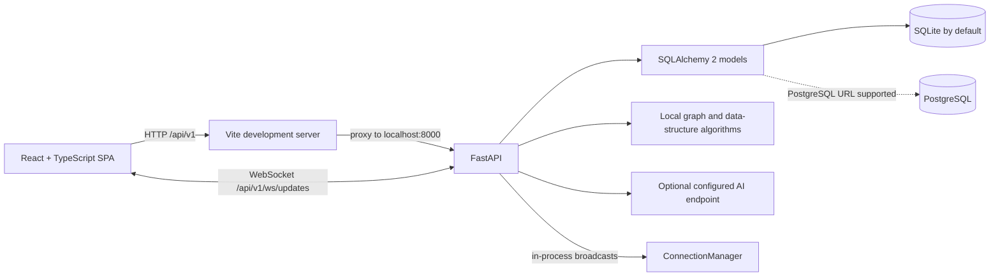

# RESQNET Current Architecture

## System overview

The diagram describes the checked-in development configuration. The optional PostgreSQL and AI paths are not evidence of a deployed or configured production integration.

## Frontend

- Entry: `frontend/src/main.tsx` mounts the React application; `frontend/src/App.tsx` declares `BrowserRouter`, public pages, protected operator routes, and the 404 page.
- `frontend/src/components/AppShell.tsx` provides the authenticated shell and opens a same-origin WebSocket.
- Pages are consolidated in `frontend/src/pages/Pages.tsx`; reusable controls and toast/error boundary are in `frontend/src/components/Ui.tsx`.
- `frontend/src/services/api.ts` is the single API client. It defaults to `/api/v1`, adds JSON and bearer headers, parses API errors, and stores the access/refresh tokens and user in `localStorage`.
- Vite development proxy: `/api` → `http://localhost:8000`; frontend dev port is 5173.
- React Leaflet consumes OSM tiles. It renders coordinates and road graph records received from the backend.

## Backend

- `backend/app/main.py` creates the FastAPI app, includes the versioned routers under `/api/v1`, exposes `/api/v1/health` and `/api/v1/health/ready`, retains a legacy `/api/health`, and registers `/api/v1/ws/updates`.
- `backend/app/api/` contains auth, emergency, ambulance, hospital, dispatch, routing, analytics, notification, DSA, and assistant routers. `graph_service.py` adapts database road records to the graph implementation.
- `backend/app/algorithms/` contains adjacency-list graph/path algorithms, shared data structures, and the greedy dispatch recommender.
- `backend/app/models.py` defines 12 tables: `users`, `emergencies`, `ambulances`, `hospitals`, `hospital_resources`, `roads`, `locations`, `dispatches`, `emergency_events`, `notifications`, `algorithm_runs`, and `refresh_tokens`.
- SQLAlchemy is configured through `DATABASE_URL`; SQLite is the default, and PostgreSQL URLs are adapted to the psycopg driver.
- Startup optionally invokes `Base.metadata.create_all()` and seeds demo data. Both toggles default to enabled. No Alembic migration environment or migration files were found.
- WebSocket connections are held in a process-local `ConnectionManager`; a multi-process deployment would not share broadcasts without a broker/pub-sub adapter.

## Authentication and authorization flow

1. The frontend submits credentials to `/api/v1/auth/login` or `/register`.
2. The backend verifies/creates the user, stores a refresh-token record, and returns access/refresh tokens plus a user object.
3. The frontend persists these values in `localStorage` and attaches the access token as a bearer token on API calls.
4. The backend uses `HTTPBearer`, decodes the JWT, loads the active user, and applies role dependencies to sensitive operations.
5. The WebSocket reads an access token from the query string and verifies it before accepting a connection.

Production hardening is required: role self-selection at signup (except Administrator), browser token storage, query-string tokens, no tenant/organization boundary, and no refresh-token cookie/CSRF policy.

## Data and trust boundaries

- Seeded locations and resource counts are fictional. Operator-submitted location updates are marked `simulated=True`.
- Public SOS stores a local emergency record and cancel-token hash; it does not notify any responder or public authority.
- Dispatch approval changes local database state only.
- The graph is a small synthetic road network. Route ETA uses a fixed multiplier.
- AI is disabled unless an endpoint and key are provided through environment variables. Provider output is not normalized into a strict response schema.

## Environment and deployment gaps

- `backend/.env.example` documents variables, but the app reads `os.getenv`; no dotenv loader is installed/configured. Export variables in the process environment or configure the deployment platform.
- `frontend/src/services/api.ts` supports `VITE_API_BASE_URL`; no production API configuration or SPA-host fallback was found.
- No Dockerfile, Compose file, root setup guide, deployment configuration, CI, or operational runbook was present.
- No migration history or tested schema-upgrade path was found.

For route-level details, see [API_REFERENCE.md](./API_REFERENCE.md). For audit evidence, see [PROJECT_AUDIT.md](./PROJECT_AUDIT.md).
